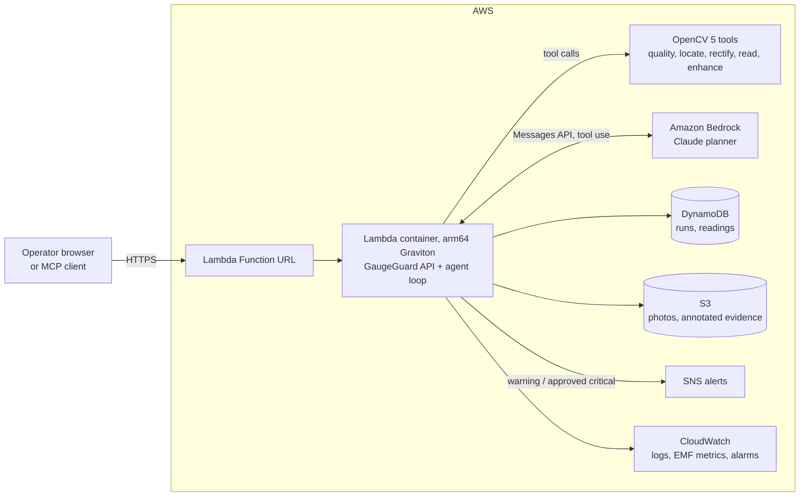
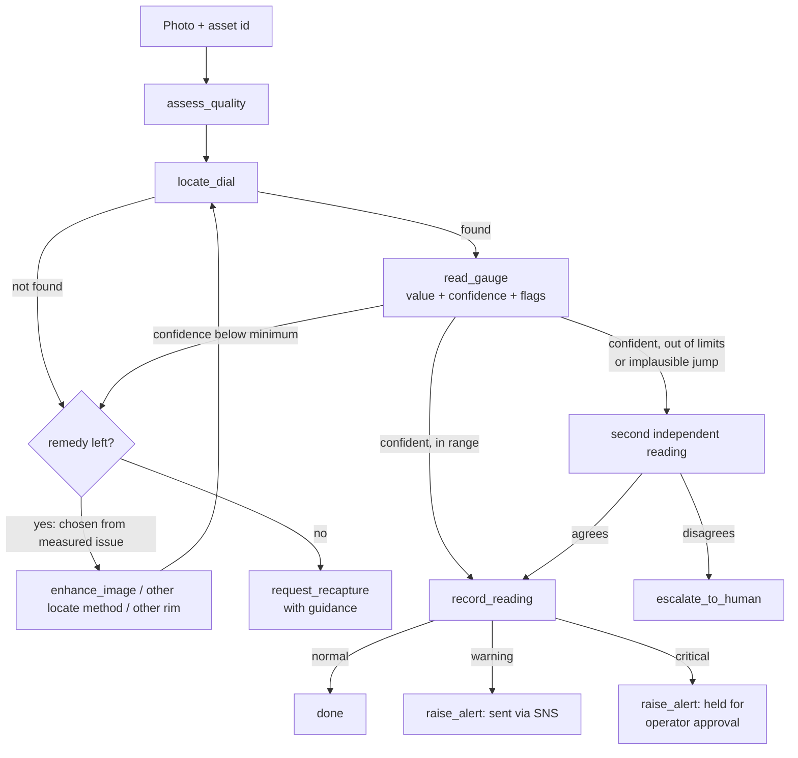

# GaugeGuard

An agent that reads analog gauges from photos with **OpenCV 5**, checks its own evidence, and decides what
to do next: record the value, raise an alert, ask for a better photo, or hand over to a person.

Built for the [OpenCV AI Competition 2026, powered by AWS](https://opencv26.devpost.com/) (Agentic Vision path).

Millions of plants still run on analog gauges that someone walks round and reads by hand. A photo-based
reader helps only if it never silently reports a wrong number. GaugeGuard is built around that: every
reading carries a confidence, and a low-confidence reading changes what the agent does next instead of
being reported.

## What it does

1. **Perceive (OpenCV 5).** Measure image quality, find the dial rim as an ellipse, undo camera tilt and
   roll, find the tick scale and the needle, and convert the needle angle to a value with a confidence.
2. **Decide (planner).** Claude on Amazon Bedrock, or a deterministic rule planner, picks the next tool
   call from the last measurement: denoise a dark frame, re-locate the rim another way, take a second
   reading to confirm an out-of-limit value, or stop.
3. **Act (guarded).** Record the reading, send a warning, hold a critical alert for operator approval,
   request a recapture with specific guidance, or escalate to a human.

Guardrails are enforced in the tools, not in the prompt, so they hold for any planner:
a low-confidence reading cannot be recorded, an out-of-limit value cannot be recorded without an agreeing
second reading, and a critical alert is never sent without a person approving it.

## Results

On 660 unseen synthetic images with exact ground truth (11 conditions including tilt, blur, low light,
noise, glare and occlusion), see [eval/results/results.md](eval/results/results.md) and
[docs/TECHNICAL_REPORT.md](docs/TECHNICAL_REPORT.md) for the numbers, the method and the failure cases.

On 14 openly licensed real photographs (`python eval/run_real.py`), the reader is not yet reliable: the
agent withheld every value and asked for a new photo, so it reported no wrong values, while always
reporting would have given a wrong value on 5 of the 9 readable photos. See section 6.1 of the report.

## Architecture



Agent workflow (perception, decision, action):



## Run it locally

Requires Python 3.10 or newer. No AWS account is needed for the rule planner.

```bash
python -m venv .venv
.venv\Scripts\activate            # Windows;  on macOS/Linux: source .venv/bin/activate
pip install -r requirements-dev.txt
python -m pytest -q               # 33 tests
python -m gaugeguard.serve        # open http://127.0.0.1:8000
```

In the page: pick a test condition, press **Generate**, then **Inspect**. You can also upload your own
photo and choose the matching asset. The trace shows each tool call, why it was chosen and what it returned.

Reproduce the evaluation and the benchmark:

```bash
python eval/run_eval.py --n 60    # writes eval/results/
python bench/bench_ops.py         # per-operation timings for this OpenCV build
```

To use the Bedrock planner locally, configure AWS credentials with access to the model, then
`set GG_PLANNER=bedrock` (PowerShell: `$env:GG_PLANNER="bedrock"`). If Bedrock cannot be reached the run
continues with the rule planner and the trace records the fallback.

## Deploy to AWS

Requires the AWS CLI with credentials, and Bedrock model access in the target region. Docker and the SAM
CLI are not needed: pip fetches the Linux arm64 wheels on any OS.

```bash
python infra/build_lambda.py
aws s3 mb s3://<artifact-bucket>
aws cloudformation package --template-file infra/template.yaml --s3-bucket <artifact-bucket> \
  --output-template-file infra/packaged.yaml
aws cloudformation deploy --template-file infra/packaged.yaml --stack-name gaugeguard \
  --capabilities CAPABILITY_IAM CAPABILITY_AUTO_EXPAND \
  --parameter-overrides DemoToken=<choose-a-token> AlertEmail=<you@example.com>
```

The stack output `Url` is the web endpoint. It creates one arm64 (Graviton) Lambda function,
a private encrypted S3 bucket with 30-day expiry, a DynamoDB table, an SNS topic and two CloudWatch alarms.
See [docs/DEPLOYMENT.md](docs/DEPLOYMENT.md) for settings, costs, teardown and what has and has not been
verified.

## Use the tools from another agent (MCP)

```bash
python -m gaugeguard.mcp_server
```

A stdio MCP server exposing `load_image` plus the same nine tools and guardrails. Example client entry:

```json
{"mcpServers": {"gaugeguard": {"command": "python", "args": ["-m", "gaugeguard.mcp_server"]}}}
```

## Repository map

| Path | Contents |
|---|---|
| `gaugeguard/vision/` | OpenCV 5 perception: `quality`, `locate`, `reader`, `enhance`, `annotate` |
| `gaugeguard/agent/` | `tools` (tools + guardrails), `policy` (rule planner), `bedrock` (Claude planner), `loop` |
| `gaugeguard/api.py`, `serve.py`, `lambda_handler.py` | HTTP API, local server, Lambda entry point |
| `gaugeguard/web/index.html` | Single-page UI, no external dependencies |
| `gaugeguard/synth.py` | Synthetic gauge renderer with ground truth |
| `gaugeguard/mcp_server.py` | MCP server |
| `eval/`, `bench/`, `tests/` | Evaluation, benchmark, tests |
| `infra/` | CloudFormation (SAM) template and the Lambda build script |
| `docs/` | Technical report, deployment notes, video script, submission checklist |

## Limitations

Stated in full in the technical report. The main ones: the reader works on synthetic images but not
yet on real photographs; it expects a single-needle circular dial with a tick scale and a visible gap; the
asset's range and limits come from a registry, not from reading the digits; and the Bedrock planner has
not yet been run against a live model (the deployed site runs on the rule planner).
